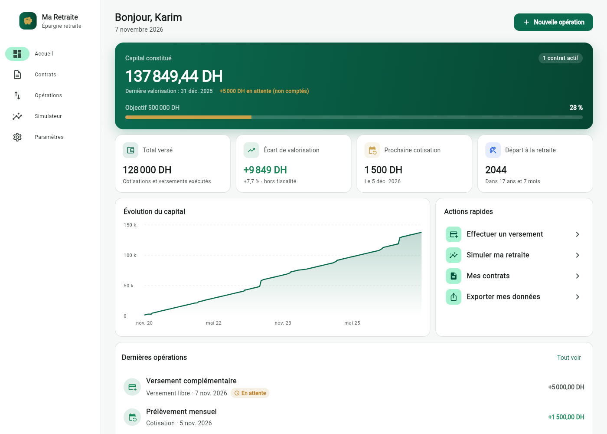
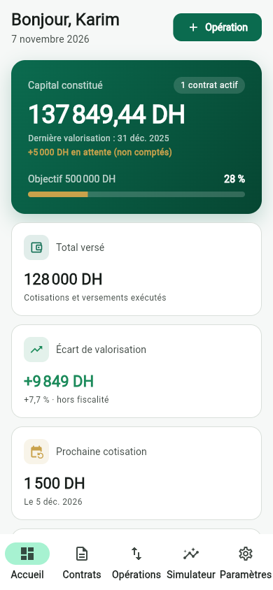
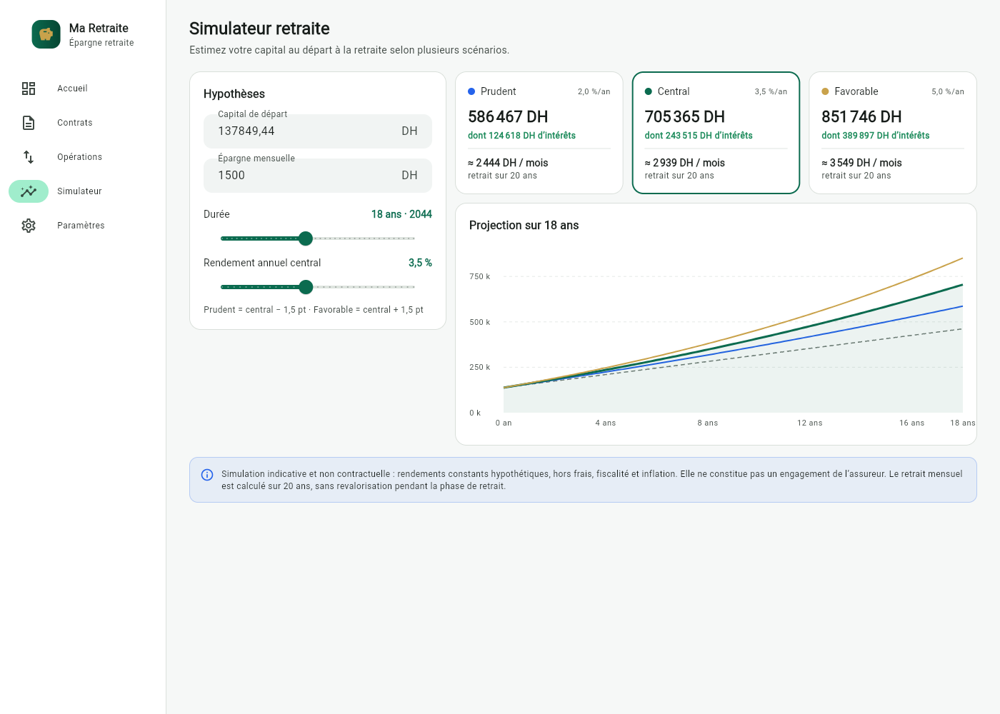
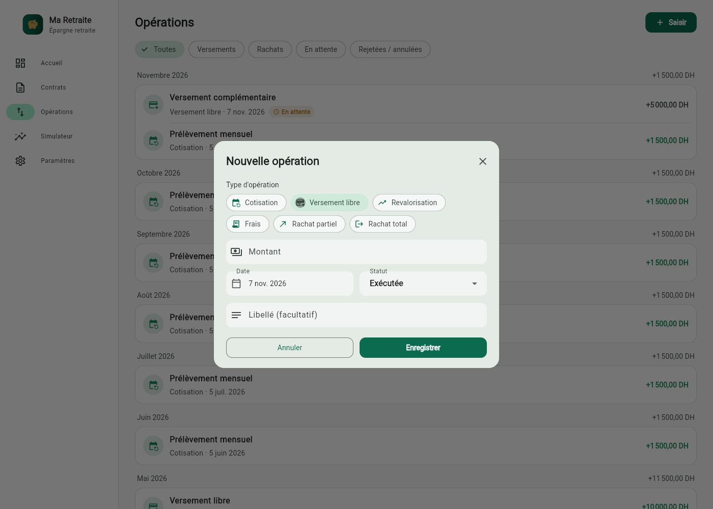

# Ma Retraite — application locale (Flutter)

Application de suivi d'épargne retraite **100 % locale**, pour **mobile et desktop** (Android, iOS, Windows, macOS, Linux).
Les données sont enregistrées dans **un fichier JSON** sur l'appareil, et peuvent être **exportées / importées** pour être utilisées sur un autre appareil.



| Mobile | Simulateur | Saisie d'opération |
|---|---|---|
|  |  |  |

## Fonctionnalités

- **Accueil** : capital constitué, total versé, écart de valorisation, prochaine cotisation, progression vers l'objectif, courbe d'évolution, actions rapides.
- **Contrats** : création / modification, périodicité, échéance, objectif, bénéficiaires (quotes-parts contrôlées à 100 %), fiche détaillée.
- **Opérations** : cotisations, versements, revalorisations, frais, rachats partiels et total ; statuts *en attente / exécutée / rejetée / annulée* ; filtres et regroupement par mois.
- **Règles métier** (paramétrables dans `lib/models/regles.dart`) :
  - une opération en attente n'est **jamais** comptée dans le capital ;
  - rachat partiel limité à 50 % de l'épargne et à 4 rachats ;
  - détection d'une demande de rachat déjà en attente ;
  - un rachat total exécuté **clôture** le contrat, qui n'accepte plus d'opération.
- **Simulateur** : scénarios prudent / central / favorable, graphique, retrait mensuel indicatif.
- **Paramètres** : export, partage (mobile), import, thème clair / sombre, données de démonstration.

## Données et transfert entre appareils

| Plateforme | Emplacement du fichier `ma_retraite.json` |
|---|---|
| Android / iOS | dossier privé de l'application |
| Windows | `%APPDATA%\ma.cdm\ma_retraite\` |
| macOS | `~/Library/Application Support/ma.cdm.maRetraite/` |
| Linux | `~/.local/share/ma.cdm.ma_retraite/` |

- **Écriture sûre** : écriture dans un fichier temporaire, puis remplacement ; la version précédente est gardée en `.bak` et restaurée automatiquement si le fichier est endommagé.
- **Export** : *Paramètres → Exporter (.json)* (ou *Partager* sur mobile : e-mail, WhatsApp, Drive, Bluetooth…).
- **Import** : *Paramètres → Importer*, avec aperçu du contenu puis choix :
  - **Fusionner** : ajoute les nouveaux éléments ; pour un même identifiant, la version modifiée le plus récemment l'emporte ;
  - **Remplacer** : remplace toutes les données de l'appareil.
- **Montants** stockés en **centimes entiers** (jamais de nombres à virgule) ; **identifiants UUID** pour fusionner sans conflit.

Exemple de fichier :

```json
{
  "app": "ma_retraite_cdm",
  "schemaVersion": 1,
  "updatedAt": "2026-11-07T10:00:00.000Z",
  "profil": { "nom": "Karim", "theme": "system" },
  "contrats": [
    {
      "id": "6f1c…", "reference": "AR-2019-004587", "produit": "Assur'Retraite individuelle",
      "dateEffet": "2019-11-05", "dateEcheance": "2044-06-30",
      "cotisation": 150000, "periodicite": "mensuelle", "objectif": 50000000,
      "statut": "actif", "beneficiaires": [], "updatedAt": "…"
    }
  ],
  "operations": [
    {
      "id": "a9e2…", "contratId": "6f1c…", "type": "cotisation", "montant": 150000,
      "date": "2026-11-05", "statut": "executee", "libelle": "Prélèvement mensuel", "updatedAt": "…"
    }
  ]
}
```

## Lancer le projet

Prérequis : [Flutter](https://docs.flutter.dev/get-started/install) (stable, Dart ≥ 3.10).

```bash
flutter pub get
flutter run -d windows      # ou macos, linux, android, ios, chrome
flutter test                # tests des règles métier et de l'export / import
```

Construire :

```bash
flutter build apk           # Android
flutter build windows       # Windows (à lancer sous Windows)
flutter build macos         # macOS (à lancer sous macOS)
flutter build ios           # iOS (macOS + Xcode)
flutter build linux         # Linux
```

## Structure

```
lib/
  main.dart                 point d'entrée, thème, localisation FR
  models/                   Contrat, Operation, AppData (format JSON), règles produit
  data/                     stockage JSON (fichier / navigateur), export-import
  state/app_state.dart      logique métier, calculs, fusion à l'import
  theme/app_theme.dart      identité visuelle (Material 3, clair / sombre)
  widgets/                  composants réutilisables (cartes, graphiques, formulaires)
  screens/                  Accueil, Contrats, Opérations, Simulateur, Paramètres
test/                       tests unitaires
```

> Application de démonstration non officielle. Les règles produit et les simulations sont indicatives et ne constituent pas un engagement d'un assureur ou d'une banque.
